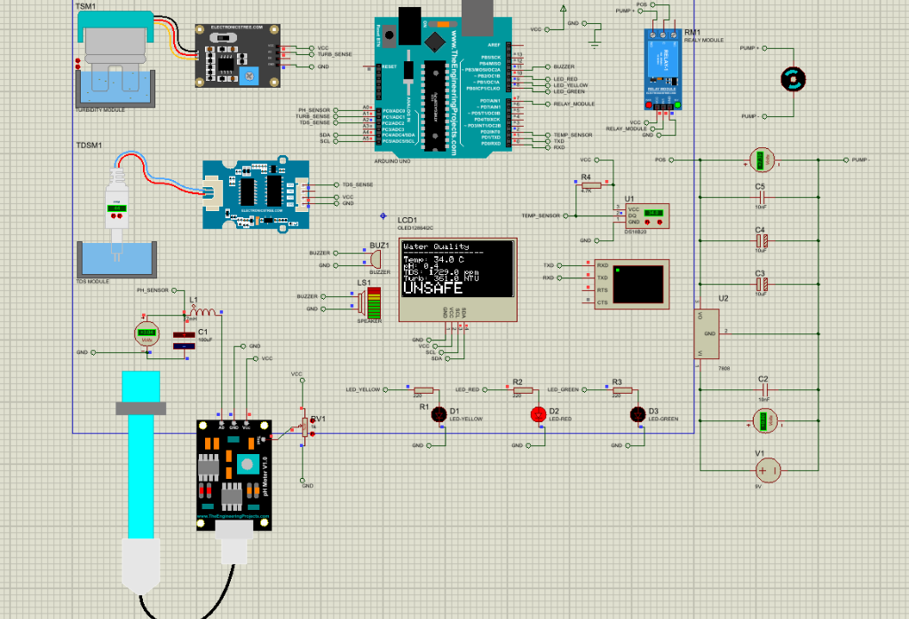
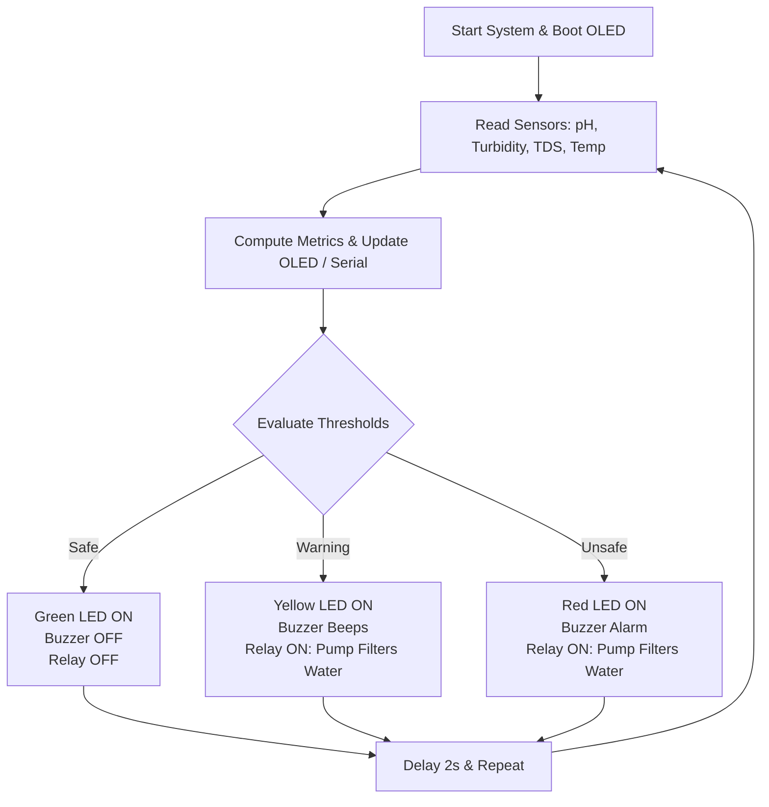

# AquaSense: Portable Water Filter and Safety Monitoring System

**AquaSense** is a compact, portable embedded system designed for real-time water quality assessment and automated multi-stage filtration. Built around an **Arduino Uno (ATmega328P)**, AquaSense monitors key physical and chemical water parameters—**pH**, **Turbidity**, **Total Dissolved Solids (TDS)**, and **Temperature**—and automatically activates a relay-driven water pump to filter contaminated water in a closed feedback loop.

---

## 📌 Project Overview & Objectives

Safe drinking water is essential for human health, yet rapid contamination checks are often inaccessible in off-grid or disaster-affected areas. AquaSense bridges this gap by combining automated sensor diagnostics with a closed-loop filtration mechanism.

* **Multi-Parameter Detection:** Measures pH, turbidity (clarity), TDS (dissolved minerals/salts), and temperature in real-time.
* **Instant Safety Feedback:** Visual output via an I2C OLED display (128×64) and tri-color LED indicators (Green, Yellow, Red), paired with an audible buzzer alert.
* **Automated Closed-Loop Filtration:** Automatically turns on a mini water pump via a 5V relay module when water is flagged as *Warning* or *Unsafe*, pumping water through multi-stage filters (sediment, activated carbon) before re-testing.
* **Portability & Cost-Efficiency:** Designed for battery power (9V / Li-ion) with low-cost, readily available components.

---

## 🔌 Circuit & Proteus Simulation Diagram

Below is the complete Proteus Design Suite schematic diagram showing the sensor modules, Arduino Uno, power conditioning, indicators, and relay-controlled pump:

---

## 🧩 Hardware Components & Pinout

### 1. Arduino Pin Mapping

| Component | Arduino Pin | Type | Description |
| :--- | :--- | :--- | :--- |
| **pH Sensor Module** | `A0` | Analog Input | Measures acidity/alkalinity ($0 - 14$ pH) |
| **Turbidity Sensor Module** | `A1` | Analog Input | Measures water clarity / suspended solids (NTU) |
| **TDS Sensor Module** | `A2` | Analog Input | Measures Total Dissolved Solids in ppm |
| **DS18B20 Temperature Sensor** | `D2` | Digital (OneWire) | Waterproof temperature probe with 4.7kΩ pull-up |
| **Relay Module (Pump Control)** | `D7` | Digital Output | Active-LOW relay controlling mini water pump |
| **Green LED (Safe)** | `D8` | Digital Output | 220Ω current limiting resistor |
| **Yellow LED (Warning)** | `D9` | Digital Output | 220Ω current limiting resistor |
| **Red LED (Unsafe)** | `D10` | Digital Output | 220Ω current limiting resistor |
| **Active Buzzer / Speaker** | `D11` | Digital Output | Audible status alert |
| **OLED Display (SDA)** | `A4` | I2C Data | 128×64 SSD1306 monochrome screen |
| **OLED Display (SCL)** | `A5` | I2C Clock | 128×64 SSD1306 monochrome screen |

### 2. Power Supply Circuitry
* **Power Source:** 9V Battery (`V1`)
* **Voltage Regulator:** LM7805 (`U2`) stepping 9V down to clean 5V VCC
* **Filtering Capacitors:** 
  * $10\,\mu\text{F}$ and $10\,\text{nF}$ bypass capacitors on input/output rails for noise decoupling.

---

## 🧪 Water Safety Thresholds & Decision Logic

Parameters are benchmarked against World Health Organization (WHO) and standard drinking water safety metrics:

| Status | Condition | Indicators | Pump / Relay | Description |
| :--- | :--- | :--- | :--- | :--- |
| **SAFE** | pH: $6.5 - 8.5$ Turbidity: $\le 5\text{ NTU}$ TDS: $\le 300\text{ ppm}$ | 🟢 **Green LED ON** Buzzer OFF | **OFF** (`HIGH`) | Water meets safety criteria for drinking/use. |
| **WARNING** | Turbidity: $\le 10\text{ NTU}$ TDS: $\le 500\text{ ppm}$ | 🟡 **Yellow LED ON** Buzzer Beep (200ms) | **ON** (`LOW`) | Marginal water quality. Automatic filtration initiated. |
| **UNSAFE** | pH $< 6.5$ or $> 8.5$ Turbidity $> 10\text{ NTU}$ TDS $> 500\text{ ppm}$ | 🔴 **Red LED ON** Continuous Buzzer Alarm | **ON** (`LOW`) | Severely contaminated water. Automatic filtration engaged. |

---

## 🔄 Closed-Loop Operation Workflow

## 🚀 Getting Started

### 1. Arduino IDE Setup
1. Open [`water_filter/water_filter.ino`](water_filter/water_filter.ino) in Arduino IDE.
2. Install the required libraries via Arduino Library Manager:
   * `Adafruit GFX Library`
   * `Adafruit SSD1306`
   * `OneWire`
   * `DallasTemperature`
3. Select your board (`Arduino Uno` or `Arduino Nano`) and COM port, then click **Upload**.

### 2. Proteus Simulation Setup
1. Open [`water.pdsprj`](water.pdsprj) in **Proteus 8 Professional**.
2. Double-click the Arduino Uno component in the schematic.
3. In **Program File**, browse and select the compiled hex file:
   `water_filter/build/arduino.avr.uno/water_filter.ino.hex`
4. Click the **Play** button at the bottom left to start real-time simulation.

---
